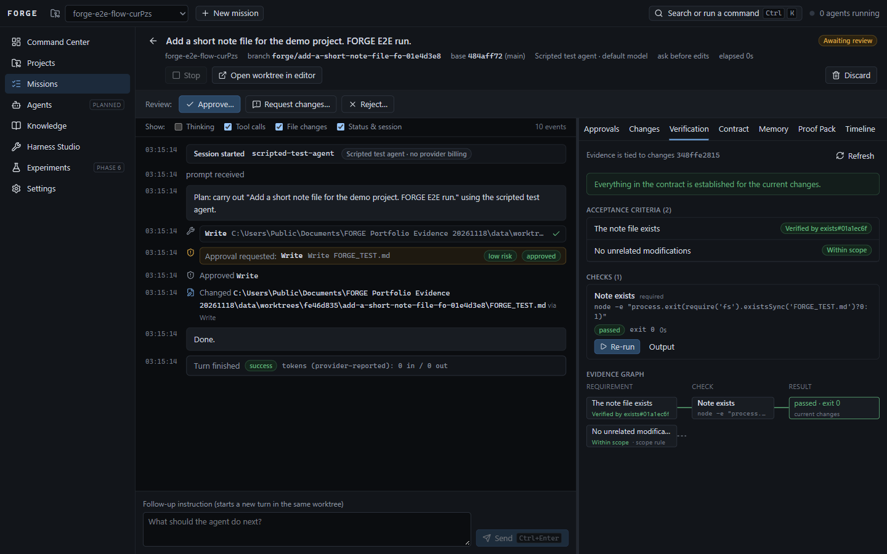
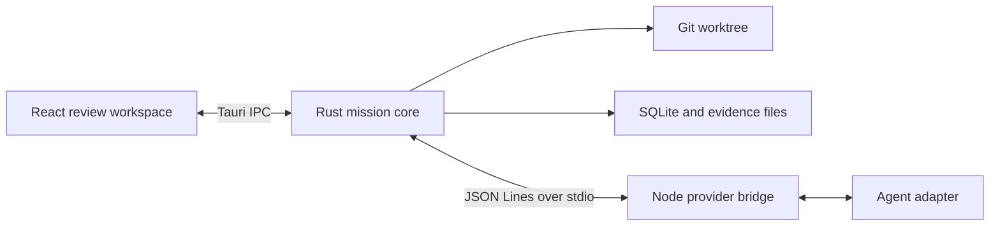
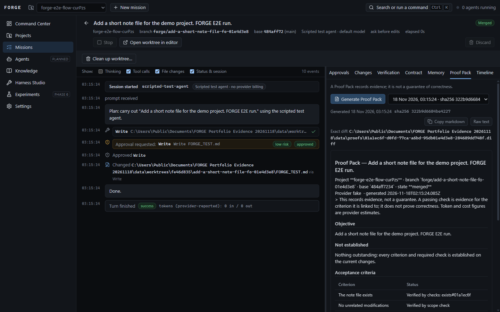

# FORGE

FORGE is a Windows desktop workspace for reviewing changes from coding agents. Run a task in an isolated Git worktree, inspect proposed edits, and attach check results to the revision you approve.



## What it does

- **Missions** create isolated Git worktrees, stream agent activity, and put tool approvals and changed files alongside the task.
- **Contracts and verification** connect acceptance criteria to required checks. Reviewers can inspect the output and see whether it still applies to the current diff.
- **Proof Packs** record the reviewed changes, check results and review decisions. Approved changes can be merged into a clean local checkout.
- **Project knowledge and Harness Studio** let reviewers verify notes for future missions, preview project instruction changes and roll them back.

## Architecture

The React and TypeScript app calls a Tauri/Rust core. Rust owns mission state, approval decisions, SQLite records and Git operations. A Node engine translates provider events and tool requests into a JSON Lines protocol used by the core.



## Run a local mission on Windows

Install Node.js 22 or later, Git, WebView2, the Rust MSVC toolchain, the Visual Studio C++ build tools and the Windows SDK. Run these commands from the repository root.

```powershell
npm ci
npm run build:engine
npm run tauri -w forge-desktop -- build --debug --no-bundle
.\apps\desktop\src-tauri\target\debug\forge-desktop.exe
```

In **Projects**, add a disposable Git repository with an initial commit. In **Missions**, create a task to add a short note and select **Scripted test agent**. Approve the write, inspect the diff in **Changes**, then review and merge. The debug app's scripted provider creates real files in the worktree and makes no model calls.

## Verification

```powershell
npm run typecheck
npm run build:engine
npm test
npm run test -w forge-desktop
```

| Layer | Local result |
| --- | --- |
| Node provider bridge | 52 tests passed |
| Rust core | 295 tests passed, six live-provider tests ignored |
| React desktop UI | 100 tests passed |
| Native WebView2 workflows | Mission approval, diff, real check, local merge and Proof Pack. Knowledge verification and injection. Harness preview, save, rollback and template dry run. |

The native workflow used a disposable Git repository and the scripted provider. A Node check verified that the note existed in the mission worktree. FORGE recorded evidence for that revision and merged the approved file back to the disposable checkout. Coverage here is functional. No throughput or provider-performance benchmark was run.

<details>
<summary>Proof Pack after local merge</summary>



</details>

## Status and limits

FORGE is an experimental single-user desktop app. An approved shell command runs with the user's privileges. Worktrees isolate Git changes, and shell approval still requires human review. Live providers have separate requirements and were outside this run. Installer packaging and macOS/Linux runtime behavior were outside this verification.

See [architecture](docs/ARCHITECTURE.md), [security boundaries](docs/SECURITY.md) and the [roadmap](docs/ROADMAP.md). The repository currently has no top-level license file.
